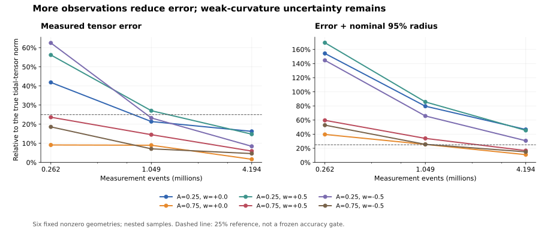

# Verified reconstruction results and scientific assessment

2026-09-23. **중단된 마지막 사례를 완료하고, 8개 고정 기하 × 3개 표본 크기 = 24개 결과 모두를 검산했다.**
이 문서는 같은 날짜의 21/24 중간 보고를 갱신한다. 원래 중단된 실행과 감사 기록은 보존했다.

**결론:** 제한된 4차원 진공 평면파 실험에서 외부 좌표·파형·짝지은 평탄 대조군을 추정기에 주지 않고, 부호와 방향을 가진 Weyl 조석정보를 정량 복원했다. 최대 표본에서 여섯 비영 곡률 사례의 상대오차는 **1.64–16.23%**였다. 별도 512회 검증의 기존 포함률 판정도 통과했다. 약한 곡률에서는 신뢰영역이 여전히 넓으며, 보편적 시공간 복원이나 사전 검정력 설계를 거친 25% 정확도 보장은 아직 성립하지 않는다.

## 1. 완료 범위와 추정 대상

기존 랜드마크 선택, 난수열, 추정식, 마스크, 허용치와 실패 규칙을 유지했다. 마지막 사례 (A,w)=(0.75,-0.5)의 중단된 난수열을 재생했고, 이미 저장된 262,144개 및 1,048,576개 표본의 관계 비트가 정확히 일치했다. 4,194,304개까지 생성한 뒤 세 단계의 추정을 마쳤다. 재추첨·사례 교체·불리한 결과 제외는 없었다.

GPU 사용 제한은 해제되었지만, 이미 실행 중이던 동결된 CPU 구현을 유지해 완료했다. 추정기 입력은 선택용 인과순서, 선택 설계, 선택 사건 ID, 앞/뒤 관계 비트, 측정 사건 수의 여섯 필드다. 생성기는 관측을 만들기 위해 기하를 사용하고, 평가기는 추정 반환 후에만 숨겨 둔 참값을 읽는다. 전체 시뮬레이션이 기하를 모른다는 주장이 아니다.

목표는 내부 관측자와 기준계에서 정의한 **무차원 조석 곡률 T_ref² C**다. 전기형·자기형 Weyl 성분 5개씩을 함께 추정하며 남는 공간 반사는 동치로 처리한다. 절대 단위의 곡률을 얻으려면 별도 시간·길이 척도가 필요하다.

## 2. 정확도와 불확실성

아래 A,w는 평가용 생성 기하의 진폭과 회전율이며 추정기에 공급한 입력이 아니다. 오차는 전기형·자기형 텐서의 Frobenius 노름을 합친 전체 조석 오차이며 잔여 반사를 고려한다.

| A | w | 상대오차 N=262,144 | 상대오차 N=1,048,576 | 상대오차 N=4,194,304 | 최대 N의 명목 반경/참값 노름 | 최대 N의 (오차+반경)/참값 노름 |
|---:|---:|---:|---:|---:|---:|---:|
| 0.25 | 0 | 41.85% | 21.37% | **16.23%** | 30.38% | **46.61%** |
| 0.75 | 0 | 9.12% | 8.98% | **1.64%** | 9.30% | **10.94%** |
| 0.25 | +0.5 | 56.20% | 27.04% | **14.76%** | 30.58% | **45.34%** |
| 0.75 | +0.5 | 23.63% | 14.50% | **5.92%** | 10.77% | **16.69%** |
| 0.25 | -0.5 | 62.49% | 23.25% | **8.42%** | 22.28% | **30.70%** |
| 0.75 | -0.5 | 18.58% | 7.09% | **4.62%** | 10.34% | **14.95%** |

모든 비영 사례에서 최대 표본의 점추정 오차가 감소했다. 강한 곡률 세 사례는 마지막 열도 25% 아래지만 약한 곡률 세 사례는 그렇지 않다. 마지막 열은 참값을 아는 시뮬레이션에서 계산한 삼각부등식에 따른 충분 상한이다. **새로운 통과 기준이나 사전등록된 정확도 판정으로 사용하지 않는다.** 반경은 기존 95% 명목 신뢰공의 반경이며 2% 연속체 편향 가정을 포함한다.

평탄한 두 사례도 보존했다. 참값이 0이므로 상대오차는 정의하지 않는다.

| 평탄 사례 | 절대오차 N=262,144 | 절대오차 N=1,048,576 | 절대오차 N=4,194,304 | 최대 N의 명목 반경 |
|---:|---:|---:|---:|---:|
| 0 | 0.29894 | 0.12681 | 0.07344 | 0.11879 |
| 1 | 0.25094 | 0.16844 | 0.05853 | 0.11729 |

24개 모두 추정과 평가를 반환했고 기존 편향 조건과 명목 신뢰공의 참값 포함 조건을 만족했다. 최대 표본에서 회전하는 비영 네 사례의 상대 연속체 편향은 1.22–1.28%였다. 하지만 이것은 **8개 고정 기하에 각각 하나의 중첩 난수열**을 적용한 진단이다. 24개의 독립 반복 실험이 아니며 그 수치로 모집단 포함률이나 90% 검정력을 인증할 수 없다. 이전 파일럿의 case 6 비포함 결과 역시 그대로 남는다.

## 3. 독립 512회 검증

별도로 동결된 평면파 혼합 모집단에서 **509/512** 사례가 편향 조건을 만족하면서 신뢰영역 안에 참값을 포함했다. 정확한 95% 양측 이항 신뢰구간은 **[0.9829726249, 0.9987900222]**이다. 하한 0.95 이상이라는 사전 기준을 충족해 기존 판정은 **SUPPORTED**다.

실패 세 건을 분모에 유지했다. 사례 275와 303은 측정 시계의 사건 수가 0이었고 사례 370은 추정값을 반환했지만 신뢰공이 평탄한 참값을 포함하지 못했다. 별도 재실행에서 사례 370의 모든 추정 필드가 저장본과 정확히 일치했다.

이 검증은 해당 모집단에서 절차의 포함률을 뒷받침한다. 좁은 오차를 보장하는 결과는 아니다. 이 모집단과 고표본 진단의 8개 고정 기하는 같지 않으므로 둘을 짝지은 정확도 개선 실험으로 합치지 않는다. 이전 256회 5차 모델 검증의 **246/256, NOT_SUPPORTED** 판정도 변경하지 않는다.

## 4. 표본 확대와 비용 외삽

V = N × 최대 조석 공분산 고유값을 비교했다. 단순한 1/N 분산 감소라면 V가 거의 일정해야 한다. 기존 파일럿과 새 측정은 같은 선택 기하를 사용하지만 측정 사건은 별도 난수열이다. 아래 오차는 평탄 사례를 포함해 비교할 수 있도록 절대 조석 오차로 적었다.

| 사례 | 기존 파일럿 절대오차 | 기존 파일럿 V | 새 N=262,144의 V | 새 N=4,194,304의 V |
|---:|---:|---:|---:|---:|
| 0 | 0.33864 | 2884.13 | 2885.24 | 3027.26 |
| 1 | 0.24102 | 2841.78 | 2853.38 | 2965.70 |
| 2 | 0.22000 | 4258.32 | 4171.28 | 4389.74 |
| 3 | 0.10847 | 2510.81 | 2508.07 | 2605.78 |
| 4 | 0.37124 | 4370.47 | 4253.78 | 4489.82 |
| 5 | 0.27301 | 3537.42 | 3536.87 | 3747.50 |
| 6 | 0.44176 | 2160.95 | 2176.94 | 2252.29 |
| 7 | 0.34326 | 3213.10 | 3199.34 | 3405.05 |

N을 16배 늘렸을 때 V는 새 최저 단계보다 약 3.46–6.43% 커졌다. 이 범위에서는 표본 확대가 분산을 줄인다는 외삽과 대체로 부합한다. 그러나 V는 추정된 명목 공분산에서 계산한 조건부 수치다. 실제 모집단 분산의 상한이나 고표본 신뢰구간의 보정이 입증된 것은 아니다.

기존 [조건부 표본 비용 공식](nested_pilot_results.md#conditional-price-of-a-later-accuracy-test)에 새 최대 표본의 V를 넣으면, 여섯 비영 고정 사례의 동시 25% 정확도·90% 검정력을 위한 계획값은 **105,625,228개**다. 기존 102,189,784개보다 약 3.36% 크다. 이는 가우스 근사, 2% 편향 한계와 V의 안정성을 전제로 한 계산이다. 검증된 예산이나 새 실험의 승인으로 사용하지 않으며 정확도 실험은 시작하지 않았다.

## 5. 기록된 계산 비용

| 항목 | 비용 |
|---|---:|
| 고유한 새 측정 사건 | 33,554,432개 |
| 중단 전 재생 비용을 포함한 추출·분류 작업 하한 | 37,224,448개 |
| 완료된 생성의 방향별 랜드마크/사건 판정 | 8,690,597,888회 |
| 관측된 중단 분량까지 더한 위 판정 하한 | 9,659,482,112회 |
| 완료된 생성 단계의 벽시계 시간 합 | 7,250.28초 |
| 24개 추정·평가 단계의 벽시계 시간 합 | 9,657.76초 |
| 위 생성·추정·평가 단계의 프로세스 CPU 시간 합 | 9,504.73초 |
| 단일 추정·평가 프로세스 최대 working set | 946.02 MiB |
| 생성 프로세스 최대 working set | 413.06 MiB |
| 24개 압축 입력 아카이브의 크기 합 | 594.49 MiB |

벽시계 값은 동시 부하가 달랐던 각 완료 단계의 합이며 통제된 속도 비교가 아니다. 중단된 원 실행의 정확한 추가 CPU·벽시계 시간은 알 수 없다. 표에는 사전 재현 검사와 별도 감사 비용도 합산하지 않았다. 이전에 3,670,016개까지 수행한 마지막 사례의 작업을 무료로 취급하지 않았다. 마지막 사례 재생의 생성·추정·평가 단계만은 약 18.94분이었다.

## 6. 과학적으로 남는 성과

**첫째, 존재 명제에서 실제 역문제로 진전했다.** 여러 인과구간의 사건 수를 이용해 랜드마크 기하와 조석 곡률을 함께 추정했다. 스칼라 하나나 알려진 파형의 진폭 하나에만 맞춘 추정이 아니다. 모형은 Weyl 성분 10개와 진공 곡률 미분 성분 24개를 자유롭게 두며 전체 공분산과 고정된 곡률 제곱 보정을 사용한다. 그렇다고 시험한 평면파 족이 임의의 10성분 곡률을 모두 탐색하는 것은 아니다.

**둘째, 정확도와 비용의 관계를 수치로 드러냈다.** 기존 중첩 랜드마크 파일럿에서는 같은 측정 사건에서 최대 명목 분산의 비율 중앙값을 0.1837까지 줄였다. 그 선택 기하를 유지한 이번 진단에서는 새 측정 사건을 늘릴 때 실제 오차도 감소했다. 관측 정보를 더 잘 사용하는 설계와 표본 확대의 역할을 분리할 수 있게 됐다. 파일럿의 분산 개선이 CPU 비용 절감을 뜻하지는 않는다.

**셋째, 성립 범위를 명시할 수 있다.** 기존 [정확 대수 증명서](identifiability_certificate.json)는 일반적인 국소 배치에서 곡률 rank 10, 곡률·미분 결합 rank 34인 예를 제공한다. 이는 국소 식별 가능성의 증거이지 무작위 랜드마크와 수치 최적화의 정확도 보장은 아니다.

또한 [유한 해상도 한계 유도](finite_resolution_obstruction.md)는 진폭은 유계이면서 주파수가 무한히 커지는 매끄러운 진공 파동족에서 유한 인과순서의 분포는 평탄한 경우에 가까워져도 중점 조석 곡률은 0으로 가지 않을 수 있음을 보인다. 따라서 고정된 유한 사건 수로 **모든 주파수의 매끄러운 파형에 균일하게 적용되는 정확도 보장**을 요구할 수 없다. 고정된 하나의 파형에서 표본을 늘릴 때의 일관성을 부정하는 명제가 아니며 우선권을 주장하는 결과도 아니다.

현재 긍정적 결론에는 4차원 진공, 물리적 부피에 따른 균일 표본추출, 정칙인 국소 영역, 시험한 진폭·회전율과 모델 편향 조건이 붙는다. 일반 Petrov 유형, 미지의 불균일 사건 밀도, 특이점, 큰 다이아몬드와 복잡한 전역 인과구조까지 정량 정확도를 입증한 결과는 없다.

## 7. 선행연구와 논문 가치에 대한 판단

| 선행연구 | 이미 알려진 내용 | 이번 연구의 차별화 후보와 남은 비교 |
|---|---|---|
| [Shuman, Partial Derivatives on Causal Sets](https://arxiv.org/html/2405.10574v1), [The Geometry of Tangent Spaces on Causal Sets](https://arxiv.org/html/2405.11805v1) | 인과집합에서 좌표·계량·접속·곡률을 구성하는 방법. 제시된 수치 곡률 실험은 주로 평탄한 1+1차원이다. | 좌표를 외부에서 받지 않는다는 점만으로 새롭지 않다. 여기서는 비영 4차원 진공 조석 텐서의 유한 표본 오차·불확실성·비용을 시험했다. 같은 입력·예산의 직접 비교는 미완료다. |
| [Puetzfeld, Obukhov, Lämmerzahl, Gravitational clock compass in General Relativity](https://arxiv.org/html/1805.10673) | 진공에서 시계 비교로 Weyl 10성분을 복원하는 체계가 이미 있다. | 여기서는 준비된 물리적 시계·운동학 대신 표본 인과순서와 사건 수로 내부 기하를 추정한다. 시계 수와 사건 수를 같은 비용 단위로 비교할 수 없다. |
| [Ahmed & Bombelli, Indications of Weyl curvature in a causal set, APS 2026](https://meetings-archive.aps.org/smt/2026/apr-r93/1/) | 평면 중력파에서 인과집합의 측지선 편차를 통한 Weyl 징후를 보고한다. 페이지는 계획된 논문을 언급한다. | 넓은 의미의 최초 Weyl 검출 주장은 불가능하다. 공개 초록만으로 완전한 텐서 추정과 보정된 정확도까지 비교할 수는 없다. 논문을 찾지 못했다는 사실은 논문이 없다는 증거가 아니다. |

문헌과 결과를 종합한 **판단**은 다음과 같다. 방법론 논문으로 정리할 만한 구체적인 성과가 있다. 가장 방어 가능한 중심 주장은 **“인과순서 자료에서 내부 기준계의 부호 있는 Weyl 정보를 추정하는 구성적 절차와, 제한된 파동족에서 검증한 불확실성 및 측정 비용”**이다. 최초성, 기존 방법 대비 우월성, 모든 진동 시공간에 대한 정확식이나 심사 통과를 입증한 것은 아니다.

후속 연구에서 가장 큰 미해결 항목은 약한 곡률의 정밀도다. 조건을 명시한 독립 고표본 정확도 검증과 동일 입력·예산의 선행 방법 비교가 주장의 강도를 직접 높인다. 단순히 시험 파형을 계속 추가하는 것은 균일 복원의 정칙성 가정이나 정확도 검증을 대신할 수 없다.

## 8. 최종 검산과 증거

고표본 최종 검산은 24개 결과의 순수 추정본/평가본 일치, 입력 해시, 여섯 필드 스키마, 기존 선택 유지, 중첩 관계 비트, 랜드마크/사건 인과 추이성을 확인했다. 전기형·자기형 텐서를 직접 구성해 반사의 parity까지 포함한 오차·편향·공분산·반경을 별도로 계산했다. 12개 동결 소스, 25개 기존 파일럿 입력, 132개 원본과 재개 복사본을 검증했다.

완료 후 마지막 사례의 N=262,144를 별도 프로세스에서 재추정했다. 파일 로딩을 해당 순서 아카이브로 한정했고 생성기·참값 평가기·GPU 라이브러리를 불러오지 않았다. **모든 추정 필드가 정확히 일치했으며 최대 차이는 0이다.** 전체 감사에는 191.15초가 걸렸다. 24개 모두를 처음부터 재추정한 것은 아니고 모든 순서나 참값의 정규좌표 사상을 새로 유도한 것도 아니다.

원래 고표본 실행 소스는 169253f3d1343ad5794a501e1a877a2888b14ea0, 재개 소스는 64b9b82이며 현재 작업 분기에서 두 이력이 모두 도달 가능함을 검사했다. 512회 검증은 병합 전 원래 MAIN의 f001de6af42ba9dbc411291178cbbd3a3e695294 구현으로 감사했다.

증거 파일은 주 작업 저장소 E:/lab/causal-spacetime/outputs에 있다.

| 파일 | SHA-256 |
|---|---|
| intrinsic_weyl_high_count_v1_continued/summary.json | e85c39648777b23ab638dbd32b435aca9089392b97d6b75e75d837d96c48486c |
| intrinsic_weyl_high_count_v1_continued.final_audit.json | 9937289a86f96272fe8446eaaefa3e3b993df791e21b6ab30fe838f86584fbcd |
| intrinsic_weyl_nested_coverage_v1_continued/summary.json | 238ac2400deda3d6553e7da628bc0c27fdb277aa6bb221d924a2d21d6ed86d27 |
| intrinsic_weyl_high_count_v1.interruption_evidence.json | 5c68aef9d1f47c0aeb8e1fee88991932e768cf4047af333921e29a3b98dfee91 |

검산 구현: [check_intrinsic_weyl_high_count.py](../../../../experiments/positive_control/check_intrinsic_weyl_high_count.py).
검산 당시 소스 SHA-256은 9f4b74dfd8eea1a1f2120786bf20dfb84322ecdb5e6a80ff753a576b6cf676b0이다.
그림의 원자료는 위 고표본 summary이며 25% 선은 설명을 위한 참고선이다.
