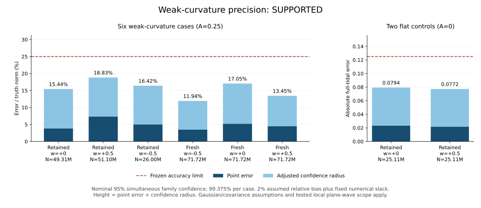

# Weak-curvature precision: results and scientific assessment

2026-09-23. **최종 판정: SUPPORTED. 약한 곡률 6개와 평탄 대조군 2개가 모두 사전 기준을 만족했고, 완료 후 독립 검산과 별도 전체 재추정도 통과했다.**

약한 곡률의 점추정 상대오차는 **3.46–7.36%**, 신뢰반경까지 합친 상대 상한은 **11.94–18.83%**였다. 명목 95% 동시 신뢰수준으로 설정한 25% 정확도 기준을 시험한 여섯 사례 모두에서 충족했다. 이 결론에는 아래의 가우스·분산·편향 가정과 시험한 국소 평면파 범위가 붙는다. 비용은 새 측정 사건 **391,794,688개**, 본 실행 약 **50.15분**, 별도 검산 약 **19.65분**이다.

이 단계는 [앞선 완료 보고](verified_results_20260923.md)에서 남은 약한 곡률의 넓은 신뢰영역을 다룬다. [사전 고정 프로토콜](weak_curvature_accuracy_protocol.md)과 실행 소스는 새 자료를 생성하기 전의 커밋 `0ff98023c90ebbdfbf74b5577e319b95eb0f58c9`에 있다. 원래 실패와 포함률 판정은 그대로 보존한다.

## 무엇을 바꾸었는가

추정 대상은 내부 관측자와 기준계에서 정의한 무차원 곡률 `T_ref² C`다. Weyl의 전기형·자기형 10성분, 진공 곡률 미분 24성분, 랜드마크 좌표를 함께 추정한다. 남는 공간 반사는 동치로 취급한다. 생성기가 숨겨 둔 좌표·진폭·파형은 추정 반환 후 평가에만 사용한다. 알려진 평면파의 진폭 하나만 맞추는 역문제가 아니다. 다만 시험 기하 자체는 특수한 평면파 족이다.

이 단계에서는 역추정식, 랜드마크 선택 규칙, 5차 모형과 고정 곡률 제곱 보정, 공분산, 최적화기를 바꾸지 않았다. 새 측정 사건 수를 사전에 계산한 정밀도 예산까지 늘렸다. 기존의 어려운 약한 곡률 기하 3개와 평탄 대조군 2개를 유지하고, 독립적으로 선택한 약한 곡률 기하 3개를 추가했다. 여덟 사례 모두 완전히 새로운 측정 난수열을 썼다.

GPU로 옮긴 부분은 인과관계 판정과 정수 가중 공분산 합이다. CPU의 물리적 부피 표본추출과 역추정 최적화는 유지했다. 기존 여덟 사례의 저장된 관계 비트를 그대로 재현했고, 별도 추정 재실행의 모든 필드가 정확히 일치한 뒤에만 새 실험을 시작했다. GPU 판정 부분의 측정된 속도는 전송을 포함해 중앙값 기준 약 48.25배였다. 전체 실험의 가속 배율을 뜻하지 않는다. 처음의 `packbits` API 실패 기록도 보존했다.

## 고정된 성공 조건과 검정력

약한 사례의 진폭은 `A=.25`, 참값의 전체 조석 노름은 `.5`다. 회전율은 `w=0, ±.5`를 사용한다. 평탄 대조군의 상대오차는 정의하지 않는다. 모든 여덟 사례가 아래 조건을 만족해야 이 단계의 판정이 SUPPORTED다.

정확도는 전기형·자기형 텐서를 합친 전체 조석 노름 기준이다. 개별 성분 하나하나의 상대오차가 25% 이하라는 뜻은 아니다. 특히 참값이 0인 성분에는 상대오차를 정의할 수 없다.

1. 지정된 관측 생성 완료, 유효한 내부 기준계, 수렴한 경계 내부 해와 완전한 rank.
2. 참값을 사용하는 별도 연속체 평가의 편향이 참값 노름의 2%와 수치 여유 `1e-10` 이내.
3. 신뢰공이 참값을 포함하고, **오차와 신뢰반경의 합**이 약한 곡률에서는 참값 노름의 25% 이하, 평탄 대조군에서는 절대값 `.125` 이하.
4. 연속체 적분 32/64차 비교의 상대차가 `1e-10` 미만이고, `V=N λ_max`가 미리 정한 사례별 상한 이하.

여덟 공을 함께 다루는 명목 신뢰수준은 95%다. Bonferroni 보정으로 개별 공의 중심형 신뢰수준은 99.375%이며, 공동 검정력 목표는 90%다. 이는 추정한 공분산에 대한 가우스 근사와 명시한 분산·편향 가정에 의존하는 설계다. 관측된 분산이 상한 안에 들어왔다고 해서 그 가정 자체가 모집단 전체에 대해 증명되지는 않는다.

`e`를 전체 조석 오차, `s=||C||`, `σ=sqrt(V/N)`, `δ=.02`, `η=1e-10`으로 둔다. `q_c²=χ²_10(.99375)`, `q_p²=χ²_10(.9875)`일 때 반경은

\[
r=\frac{q_c\sigma+\delta\|\widehat C\|+\eta}{1-\delta}.
\]

반경 계산의 `V`는 관측된 `N λ_max`이며, 검정력과 표본 크기를 계획할 때는 이를 사전에 정한 상한으로 대체한다. 그 상한이 실제 확률 오차까지 지배한다는 것은 계획의 가정이다.

계획상의 확률 사건에서 `e≤q_p σ+δs+η`, 삼각부등식으로 `||Ĉ||≤s+e`이므로

\[
e+r\leq\frac{(q_c+q_p)\sigma+2\delta s+2\eta}{1-\delta}.
\]

따라서 25% 정밀도의 충분 표본 크기는

\[
N\geq\frac{V(q_c+q_p)^2}{(0.205s-2\eta)^2},
\qquad (q_c+q_p)^2=94.18944697204289.
\]

반경이 간신히 경계에 닿는 표본 수가 아니라 검정력을 포함한 수치다. 실제 분산이 고정되고 편향 가정이 유지되는 영역에서 필요한 사건 수는 대략 `1/s²`로 증가한다. 임의로 작아지는 곡률을 같은 예산으로 같은 상대정밀도로 복원했다는 결론은 나오지 않는다.

## 최종 수치와 검산

여섯 약한 곡률 사례의 참값 노름은 모두 `.5`다. 아래 오차·반경·편향은 그 노름으로 나눈 백분율이다. 기존 기하도 측정 사건은 전부 새로 생성했다. 실패·누락·재추첨·표본 연장·기준 변경은 없다.

| 사례 | 선택 기하 | w | 측정 N | 점오차 | 신뢰반경 | 오차+반경 | 연속체 편향 |
|---:|---|---:|---:|---:|---:|---:|---:|
| 2 | 기존 | 0 | 49,311,744 | 3.85% | 11.59% | **15.44%** | 0.00410% |
| 3 | 기존 | +0.5 | 51,101,696 | 7.36% | 11.47% | **18.83%** | 1.23900% |
| 4 | 기존 | -0.5 | 26,001,408 | 5.03% | 11.39% | **16.42%** | 1.28226% |
| 5 | 신규 | -0.5 | 71,720,960 | 3.46% | 8.47% | **11.94%** | 1.25385% |
| 6 | 신규 | 0 | 71,720,960 | 5.20% | 11.85% | **17.05%** | 0.00278% |
| 7 | 신규 | +0.5 | 71,720,960 | 4.48% | 8.98% | **13.45%** | 1.26252% |

평탄한 두 대조군은 각 N=25,108,480이며, 아래는 무차원 절대값이다.

| 사례 | 절대 점오차 | 신뢰반경 | 오차+반경 | 고정 기준 |
|---:|---:|---:|---:|---:|
| 0 | 0.023320 | 0.056036 | **0.079355** | 0.125 |
| 1 | 0.021657 | 0.055592 | **0.077248** | 0.125 |

기존 세 기하의 이전 N=4,194,304 진단과 비교하면 다음과 같다. 이전 열은 개별 95% 명목 반경으로 계산한 설명용 상한이고, 새 열은 개별 99.375% 반경을 쓴 사전 정확도 판정이다. 같은 신뢰수준의 비교가 아니며 이전 진단을 사후에 새 기준으로 재판정하지 않는다. 새 측정 난수열도 이전과 독립이다.

| 기존 기하의 w | 이전 오차+반경 | 새 오차+반경 | V=N λ_max 변화 |
|---:|---:|---:|---:|
| 0 | 46.61% | 15.44% | -0.124% |
| +0.5 | 45.34% | 18.83% | +0.449% |
| -0.5 | 30.70% | 16.42% | -0.174% |

이 세 기하에서 `N × 명목 분산`이 거의 유지됐다는 점은 표본 증가로 분산을 줄인다는 계획과 부합한다. 새 사례 6의 V=6718.54는 과거 약한 곡률 모집단의 관측 최대치 6622.57보다 컸지만, 사전 상한 8000 안에 있었다. 여덟 사례의 상한 대비 관측 V 비율은 최대 84.0%였다. 이것은 관측된 공분산의 안정성이지 실제 모집단 분산의 상한 증명은 아니다.

별도 [검산 코드](../../../../experiments/positive_control/check_intrinsic_weyl_weak_accuracy.py)는 실행기의 판정 함수를 부르지 않고, 전기형·자기형 텐서와 반사의 부호를 직접 구성해 오차·편향·공분산 반경을 다시 계산했다. 자유도 10의 카이제곱 분위수도 닫힌 CDF의 이분법으로 따로 구해 표본 수와 신뢰수준을 확인했다. 기존 95% 평가 기록도 그대로 검증했다.

19개 소스, 25개 기존 파일럿 입력, 3개 계획 근거와 56개 사례 산출물 해시를 확인했다. 모든 입력의 여섯 필드 스키마, 순서 기반 선택 규칙, 랜드마크/측정 사건 인과 추이성을 검산했다. 신규 선택 3개를 CPU로 재생했고, 여덟 측정 난수열 각각의 첫 4096개 관측을 CPU로 재생해 관계 비트가 정확히 일치함을 확인했다. 전체 3.92억 개를 다시 생성한 것은 아니다.

그 뒤 사전에 지정한 신규 사례 5의 **71,720,960개 관측 전체**를 별도 프로세스에서 다시 추정했다. 추정 반환 전 허용된 파일은 해당 인과순서 아카이브 하나였고, 생성기·참값 모듈은 로드되지 않았다. **모든 추정 필드가 원본과 정확히 일치했다.** 전체 검산 1178.77초 중 이 재추정은 283.41초였다. 이는 별도 수치 구현과 재실행에 의한 검산이며, 기존 참값의 정규좌표 사상과 부피 적분기는 재사용했다.

## 실제 계산 비용과 증거

| 항목 | 기록값 |
|---|---:|
| 새 측정 사건 | 391,794,688개 |
| 신규 선택 사건 / 별도 제공한 끝점 | 12,288개 / 6개 |
| 측정 단계의 방향별 관계 판정 | 98,120,974,336회 |
| 본 실행 경과 시간 | 3009.22초, 약 50.15분 |
| 생성 단계 벽시계 합 | 1023.41초 |
| 추정·참값 평가 단계 벽시계 합 | 1837.03초 |
| 위 생성·추정·평가의 프로세스 CPU 시간 합 | 2830.06초 |
| 추정·평가 프로세스 최대 working set | 51.53 GiB |
| 생성 프로세스 최대 working set | 4.58 GiB |
| 8개 측정 아카이브 총 크기 | 11.55 GiB |
| 완료 후 별도 검산 | 1178.77초, 약 19.65분 |

본 실행의 경과 시간에는 사전 작업 경로 재현과 해시 검사가 포함된다. GPU 동등성 검증과 완료 후 검산은 별도다. 검산의 선택 사건 12,288개 및 측정 사건 32,768개 재생은 기존 난수열의 반복 작업이며 새로운 과학 표본으로 더하지 않았다. GPU 시간은 위 프로세스 CPU 시간으로 측정되지 않는다.

실행 환경은 Ryzen 7 9800X3D, RTX 5090, 운영체제 인식 RAM 125.56 GiB의 Windows 11이다. Python 3.14.0, NumPy 2.5.3, SciPy 1.18.1, CuPy 14.2.0, CUDA runtime 13.2를 사용했다. BLAS/OMP 스레드 수는 고정된 1이다. 생성과 역추정을 순차 실행했고 모든 판정 관련 소스 해시는 유지했다. 이 기계의 실제 비용을 제시한 것으로, 다른 환경의 실행 시간이나 전체 파이프라인의 48배 가속을 주장하지 않는다.

원자료와 영수증은 `E:/lab/causal-spacetime/outputs` 아래에 있다. 원본 summary의 `PENDING_INDEPENDENT_POST_COMPLETION_AUDIT` 문구는 실험 종료 시점의 기록으로 보존했으며, 후속 검산 완료는 별도 영수증에 기록했다.

| 파일 | SHA-256 |
|---|---|
| intrinsic_weyl_weak_accuracy_v1/summary.json | b153bd0c0c3de84fc993e36cd77613a89e2f839eceb7941a036a5826d098806e |
| intrinsic_weyl_weak_accuracy_v1/manifest.json | c3c47113a95cadb5d2c77efc73161498aa5e415a0a8cbe46b151bb1d1a6a2e93 |
| intrinsic_weyl_weak_accuracy_v1.final_audit.json | f37fc1b3902a6257ff2e4cbb676893fba3f1ee0885882bd78cd62e2deb005035 |
| intrinsic_weyl_gpu_equivalence_v2.json | baa7a69e68f2becb98eb41e776618a491618375fdde64483f5386408112a97c9 |

검산 시점의 소스 커밋은 `30d509c995c9548aa25e1e2fda2888dd050481d7`, 검사 파일 해시는 `59cfa4175b2c570113aa3ebbbf4fe3658da2d2e2726fa1ef80f069f343411a25`다. 실험 소스 커밋과 검산 커밋은 현재 작업 분기의 실제 조상이다. [그림 생성기](../../../../experiments/positive_control/plot_intrinsic_weyl_weak_accuracy.py)는 검산 영수증과 summary 해시가 일치하는 완료 자료만 읽는다.

## 과학적 의의와 남는 한계

이 실험이 확인한 진전은 **인과순서 자료에서 곡률을 추정하는 절차에 실제 정밀도와 측정 비용을 붙인 것**이다. 이전에는 약한 곡률의 점추정이 25% 안으로 들어와도 신뢰영역이 넓었다. 이번에는 그 반경까지 사전에 고정한 정확도 조건에 포함하고, 측정 표본과 실패 처리 규칙도 결과 전에 고정했다. 독립 검산은 원자료 해시·인과 추이성·선택 규칙과 텐서 오차를 확인했고, 완료 후 별도 프로세스에서 지정된 사례 전체를 다시 추정했다.

물리적 내용은 **Ricci 스칼라가 0인 진공에서도 남는 조석 정보를 다룬다**는 데 있다. 단일 스칼라 곡률이 평탄한 경우와 같다고 해서 중력파의 Weyl 텐서까지 0인 것은 아니다. 여러 인과구간의 관계를 함께 사용해 그 정보를 정량 추정하는 것이 연구의 대상이다. 이 구별 자체가 새 물리 법칙이라는 주장은 아니다.

이번 성공의 해석 범위는 다음과 같다.

- **정밀도 확보와 표본 효율은 다른 성과다.** 이번에는 큰 표본 비용을 지불한다. 측정 사건 수 자체를 줄인 새 통계 추정법이나 다른 방법보다 우수한 효율을 입증하는 실험이 아니다.
- **8개 사례의 성공은 포함률의 새 모집단 검증이 아니다.** 앞선 512회 실험의 509/512 결과는 N=262,144의 다른 혼합 설계를 검증했다. 새 고표본·동시 신뢰수준의 실제 포함률을 그 결과가 자동으로 인증하지 않는다.
- **참값 기반 편향 검사는 적용 범위의 확인이다.** 미지의 실제 파형을 인과순서만으로 보고 모형 편향을 인증할 수 있다는 뜻이 아니다. 모든 결과는 물리적 부피에 따른 균일 표본추출, 4차원 진공, 정칙인 국소 영역과 시험한 회전율에 한정한다.
- **완전한 일반성은 남아 있다.** 일반 Petrov 유형, 모든 진폭·주파수, 특이점, 큰 다이아몬드와 복잡한 전역 인과구조에 대한 정확도를 보이지 않는다. 절대 단위의 곡률에는 외부 척도가 추가로 필요하다.

논문 가치에 대한 판단은 정량 역문제의 방법론으로 해야 한다. 인과순서에서 접속과 곡률을 추정하는 연구는 이미 있으며, [Shuman의 접공간 구성](https://arxiv.org/html/2405.11805v1)은 평탄한 1+1차원에서 수치 검증을 제시한다. [Gravitational clock compass](https://arxiv.org/html/1805.10673)는 진공 Weyl 성분을 준비된 시계들로 복원하는 공식을 제공한다. [Ahmed–Bombelli의 APS 2026 초록](https://meetings-archive.aps.org/smt/2026/apr-r93/1/)도 인과집합의 평면 중력파에서 Weyl 곡률의 징후를 보고한다. 따라서 최초 곡률 복원이나 최초 Weyl 검출을 중심 주장으로 삼을 수 없다.

우리 연구의 차별화 후보는 **외부 좌표·파형을 추정기에 공급하지 않는 4차원 비영 진공 조석 텐서 역문제, 유한 표본 불확실성, 사전 설정된 정확도와 비용을 함께 제시하는 구성적 방법**이다. 같은 입력과 계산 예산으로 선행 방법을 구현한 직접 비교가 없으므로 우월성은 미입증이다. 제한된 수치 방법론 논문을 강화할 수 있는 결과이며, 새로운 물리 법칙이나 심사 통과 보장은 아니다.
