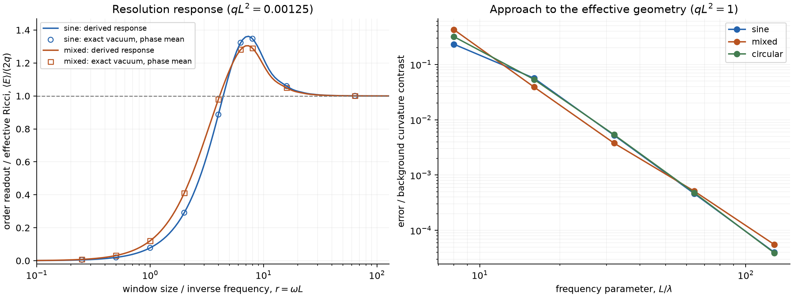

# First challenge: an energy response survives, with two important obstructions

2026-09-23. This is a completed **deterministic continuum diagnostic**, not a
finite-event accuracy verdict and not a discovery/priority declaration. The
approved discovery-oriented question is retained; no submission is proposed.

The [pre-execution derivation and design](design.md) at commit
`7abd689df3be6253deabf37b6470ebcdf31932de` predicted the response before any
scientific cases ran. Its core mechanism and its weak-wave transfer formula
survived the first numerical challenge. A stronger claim of a common monotone
crossover curve does not survive the calculation. A stronger claim of identifying
the gravitational-wave origin of unresolved energy has a mathematical obstruction.

## 1. What was actually checked

- 45 exact-vacuum limit cases: three energies, three waveform/polarization
  families, five frequencies, at fixed phase.
- 36 weak-wave transfer cases, each averaging 12 phases: 432 exact-vacuum ODE
  solutions. The two energies test the order of the approximation error.
- 49 additional solutions for the three prespecified numerical/phase refinements.
- 160 evaluations of the derived transfer curve; these are predictions, not
  additional independent observations.

The 526 scientific ODE solutions and quadratures took 64.24 seconds on the CPU.
No GPU or finite sprinkling was used. All 244 output rows were retained.

Engineering controls passed: flat order fraction, exact constant-Ricci
convolution, circular polarization's vacuum identity, a separate Brinkmann
Jacobi ODE against the Rosen kernel, and closed/integral transfer-formula
agreement. The source passes Ruff. A too-tight one-sided finite-difference
derivative check was corrected to a centered derivative **before** the source
was frozen; it was not a changed scientific gate.

## 2. The new candidate: a predictive resolution response

For a weak linearly polarized wave, the phase-averaged population observable
obeys the derived expression

\[
\mathcal E(L)=\frac{105}{2L^2}(1-10P_2),\qquad
\langle\mathcal E(L)\rangle=2\sum_n q_nF(\omega_nL)+O(q^2L^2).
\]

Here \(P_2\) is the fraction of causally related event pairs in the population,
and \(q_n\) is the derivative-energy weight of the nth Fourier component.
The elementary \(F\), including a cosine-integral closed form, is derived in
design Eqs. (8)--(12). It was not fit to the following results. The mixed wave
prediction is **0.8 F(r) + 0.2 F(2r)** with no changed coefficient.

At \(qL^2=0.00125\), exact vacuum solutions give:

| Profile | r = omega L | Derived response E/(2q) | Exact phase mean |
|---|---:|---:|---:|
| sine | 0.25 | 0.004984081 | 0.004986782 |
| mixed | 0.25 | 0.007957212 | 0.007963794 |
| sine | 2 | 0.291212370 | 0.291316269 |
| mixed | 2 | 0.410353182 | 0.410518489 |
| sine | 8 | 1.347265896 | 1.347358782 |
| mixed | 8 | 1.289780965 | 1.289884026 |
| sine | 64 | 1.000532905 | 1.000616261 |
| mixed | 64 | 1.000435020 | 1.000518475 |

Across all 18 cases at this q, the largest relative prediction discrepancy is
**0.08273%**. At twice q it is 0.17349%. On halving q, residuals become
0.4768--0.5000 of their former values, consistent with the next-order term in
the normalized response. This is a deterministic approximation comparison,
not a sampling confidence interval or proof of the remainder estimate.

The important qualitative prediction also survived: **the readout overshoots
the effective Ricci value**. At r=8, the sine case reads about 1.347 times the
limiting value. The analytic grid reaches 1.36206 near r=7.367; this is only the
largest value on the frozen grid, not a rigorously located global maximum.
The overshoot is a property of the chosen causal statistic's transfer function;
it is not extra physical energy or a violation of energy conservation.

The response is not waveform independent at finite resolution. Equal-energy
sine and mixed waves have different crossover curves, predicted by their
spectral weights. They approach the same unresolved limit. Moreover, phase
averaging is essential to the stated formula: at r=8 the individual sine
responses span 1.19759--1.49712, and the mixed responses span
0.94428--1.44576. A single unknown-phase diamond cannot be assigned the phase
mean without an argued sampling/ergodicity model.



The portable source for this figure is
`experiments/positive_control/summarize_order_wave_energy.py`. A copy of the
raw evidence and plot is committed alongside this report.

## 3. The unresolved-energy limit

At lambda=1/128, all nine energy/profile combinations approach the **nonlinear**
effective-background probability, not just its linear curvature approximation.

| q L^2 | Background P2 | Largest absolute discrepancy across three profiles |
|---:|---:|---:|
| 0.25 | 0.099031487832 | 4.107e-8 |
| 1 | 0.095919175686 | 2.263e-7 |
| 4 | 0.079322961531 | 3.135e-6 |

The worst discrepancy is **0.01516% of the curvature contrast**
`0.1 - background P2`. This does not estimate an asymptotic rate from five
frequencies. The minimum sampled Rosen scale factor is 0.4383, within the
positive coordinate patch. No caustic/singularity/global-topology extension was
tested.

The largest final quadrature difference in the 45 limit cases was 1.455e-11.
For the weak-wave cases it was 1.665e-16 in P2. The separately tightened mixed
q=4, r=128 calculation changed P2 by 1.527e-16. Combining tighter ODE/quad
settings with 24 rather than 12 phases changed the two selected normalized
weak-wave responses by 2.623e-12 and 8.742e-13. These are convergence checks,
not interval-arithmetic certificates.

The population limits fail to commute: shrink a window inside each fixed
smooth vacuum metric and the Ricci-normalized readout tends to zero; average
away the wavelength first and then shrink the window, and it tends to 2q.
This operational manifestation is consistent with known high-frequency
backreaction. The novelty candidate is the **explicit finite-resolution
transfer law and its inverse-information implications**, not the existence of
that backreaction or generic curvature-from-chains.

## 4. Two ways the stronger hypothesis fails or remains unfinished

### Energy origin is not identifiable at fixed N in the unresolved limit

The proof in design section 2 applies to the **whole finite-order law**, not
only P2. For each fixed event count N, the vacuum wave's poset law converges in
total variation to the law of its effective null-matter geometry. Any test
based on that finite poset therefore loses its power to distinguish the two
origins in the limit. With a common known density, the Poisson count laws also
converge because diamond volumes converge; truncating the count tail extends
the same argument to a Poisson-sprinkled order.

Thus an observer-relative *effective geometry/energy projection* can remain
observable while the *wave versus matter origin* is lost. There is no method
hidden in additional order motifs that defeats this fixed-N limit. Increasing
N jointly with frequency is a different question whose required rate has not
been derived. This proof was produced in the same research pass and still
requires independent scrutiny.

### Raw pair counts are an extremely costly finite-event instrument

This is an additional post-diagnostic calculation, not a frozen power result.
The [existing exact degree-moment formula](../window_response/plane_wave_chain_hierarchy.md)
reduces in flat 4D to
\(E[p(X)^2]=1/50\), \(E[p(X)]=1/10\), and
\(\operatorname{Var}(p(X))=1/100\), where p(X) is the conditional probability
that another point is related to X. For example the first moment follows from
the flat chain formula; the second is
\(6[2B(6,2)/15+B(4,4)/45]=1/50\). Therefore, exactly in flat space,

\[
\operatorname{Var}(\widehat P_2)
=\frac{0.04N+0.10}{N(N-1)},\qquad
\operatorname{SE}(\widehat{\mathcal E})\simeq\frac{105}{L^2\sqrt N}.
\]

Counting N(N-1)/2 pairs does **not** give N(N-1)/2 independent observations.
In the weak-field, unresolved regime, the relative standard error is about
\(52.5/(qL^2\sqrt N)\). Under a normal planning approximation, placing a
95% two-sided interval wholly inside a 25% accuracy band with 90% probability
uses \(z_{.975}+z_{.95}\), not the break-even \(z_{.975}\) alone:

\[
N\simeq\left[\frac{(z_{.975}+z_{.95})52.5}{0.25qL^2}\right]^2.
\]

For the very weak diagnostic value qL^2=0.00125 this is approximately
**3.67e11 events**. This is an indicative cost for the raw P2 estimator under
that normal/weak-field approximation, not an impossibility bound for every
order observable, a completed power study, or a price for all parameter
regimes. It prevents the sub-0.1% continuum discrepancy from being presented
as practical finite-event precision. No such campaign was launched.

## 5. What is worth attacking next

The live question is now more specific: **can a finite-order, multiscale
observable retain the effective energy with a usable N-versus-wavelength
resolution law, without receiving the wave profile, coordinates, or true q?**
That is the missing discovery-sized result. More continuum cases alone do
not answer it. The next challenge must freeze the data boundary and price the
correlated-event noise before running; unseen spectra and unknown phases must
be genuine holdouts. Effective-energy reconstruction and wave/matter origin
discrimination must have separate verdicts because the fixed-N theorem already
blocks the latter in the complete unresolved limit.

Primary surrounding results remain [Huneau--Luk](https://arxiv.org/abs/2404.07659),
[Harte](https://arxiv.org/abs/1502.03658), and
[Roy--Sinha--Surya](https://arxiv.org/abs/1212.0631).
Bounded searches for causal-set/Isaacson/Burnett/wave-energy, causal-diamond
averaging, and ordering-fraction plane-wave combinations did not retrieve the
same transfer formula. This is **not** a priority result, and it does not rule
out equivalent work under another observable or notation. No journal-readiness
claim follows from this first challenge.

## Reproduction and evidence

Output directory on the research host:
`E:/lab/causal-spacetime/outputs/order_wave_energy/first_challenge_20260923`.
Portable evidence copy: [evidence/manifest.json](evidence/manifest.json),
[evidence/rows.jsonl](evidence/rows.jsonl), and
[evidence/summary.json](evidence/summary.json).

- Source commit: `7abd689df3be6253deabf37b6470ebcdf31932de` (reachable ancestor).
- Design SHA-256: `95453b63d5df4a2e831150d3654cfb52f2647df09d357b624cfbb96d5d80cb94`.
- Source SHA-256: `91cc0cfe12672892ea6e8abdd21f4d0b864bec8b39b5a2a80292be2199266c62`.
- Raw rows SHA-256: `4daffee70c7da1024dbaa52c65e277dff69f5e17b1f95b2ae50371737ee30c18`.
- Runtime: Python 3.14.0, NumPy 2.5.3, SciPy 1.18.1.
- `manifest.json`, `rows.jsonl`: original result and provenance, retained unchanged.
- `summary.json`, `response.png`, `response.pdf`: post-run report products.

From a clean source checkout with the installed experiment dependencies:

```powershell
rtk proxy E:/lab/causal-spacetime/.venv/Scripts/python.exe experiments/positive_control/order_wave_energy.py --self-check
rtk proxy E:/lab/causal-spacetime/.venv/Scripts/python.exe experiments/positive_control/order_wave_energy.py --output NEW_OUTPUT_DIRECTORY
rtk proxy E:/lab/causal-spacetime/.venv/Scripts/python.exe experiments/positive_control/summarize_order_wave_energy.py NEW_OUTPUT_DIRECTORY
```

The runner refuses an existing output directory or a dirty checkout. The
summarizer verifies source/design bytes against the recorded reachable Git
commit and verifies the raw-row hash and the expected row counts before
creating report products. This report is descriptive: it does not retroactively
introduce a statistical pass threshold for the diagnostic.
