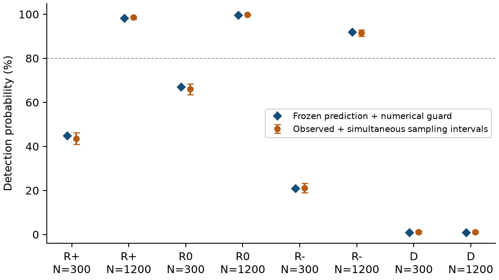

# 관측 영역에 따른 곡률 응답 — 보완연구 결과

2026-09-21. 이번에 승인한 계획의 유도·파일럿·동결 확인·원고 작성을 완료했다.
**주 확인 판정은 `PREDICTIONS_SUPPORTED`다.** 이것은 정한 8개 조건에서
관계 비율 판별기의 검출률 예측이 허용 오차 안에 들었다는 뜻이다.
학술적 최초성·게재 가능성·새로운 시공간 이론의 증명이라는 뜻은 아니다.

## 1. 이전 원고보다 실제로 추가된 것

이전에는 강한 한 조건의 분리와 여러 영역의 탐색이 있었다. 이번에는
**관측 영역이 신호의 부호·차수를 바꾸는 계수를 직접 구하고, 그 계산에서
보지 않은 확인 표본의 성능을 예측했다.** 표본 수만 늘린 작업으로 끝나지 않았다.

모형은 `ds²=2du dv+A(x²−y²)du²+dx²+dy²`, `Δu=Δv=1`, `0≤A≤2`다.
세 사각 영역은 같은 부피 12이며 횡방향 폭이 각각 `(2,6)`, `(√12,√12)`,
`(6,2)`다. Diamond는 축 위의 두 끝점을 고정한 별도 모집단이다.
관측량 `f`는 연결(link)이 아니라 **인과적으로 관계된 모든 무순서 쌍의 비율**이다.

`E[f]=p₀+c₁A+c₂A²+o(A²)`의 계수는 다음과 같다. 시뮬레이션 적합값이 아니다.

| 영역 | 평탄 평균 p₀ | 선형 계수 c₁ | 이차 계수 c₂ |
|---|---:|---:|---:|
| R+ | 0.02380872630 | +0.04051927709 | +0.05074242895 |
| R0 | 0.02454196871 | 0 | +0.00572728722 |
| R− | 0.02380872630 | −0.04051927709 | +0.05074242895 |
| D | 0.10000000000 | 0 | −0.00030423280 |

R+와 R−의 선형항은 횡방향 축 교환으로 정확히 반대가 된다. 대칭 사각 영역은
선형항이 상쇄되지만 양의 이차항이 남는다. Diamond에는 경계와 정규화의 변화도
들어가며, 그 이차항은 **음수**다. 두 대칭 영역도 같은 응답을 보이지 않는다.

Diamond에서는 평균뿐 아니라 공유 사건 공분산도 낮은 차원의 적분으로 줄였다.

```text
p_D(A)    = 1/10 − (23/75600) A² + O(A⁴)
zeta_D(A) = 1/100 − (211/4158000) A² + O(A⁴)
```

사각 영역은 `o(A²)`까지만 증명했다. 짝함수라는 이유로 `O(A⁴)`를 주장하지 않는다.
유한 A의 검출력은 절단한 다항식 대신 전체 인과관계 적분으로 계산했다.
Diamond의 부피는 평탄할 때 π/6이며 사각 영역과 다르다. 따라서 고정 N에서의
비교는 같은 물리적 밀도의 비교가 아니다.

이 결과는 [이론 노트](../window_response_theory.md)와 원고 본문/부록에 유도했다.
[기호 계산 검산](derive_exact.py)은 원자료를 읽지 않고 모든 폐형식 계수를 정확히
재계산한다. 24/40-node 수치 적분, 독립 측지선 경계값 풀이, diamond 단면 적분도
대조했다. 기호 계산은 확인 데이터 이후에 재현용으로 정리했으며, 기존 동결 계수를
바꾸거나 결과에 맞춰 새로 적합하지 않았다.

## 2. 확인 결과: 사전 기준 16개 모두 통과

파일럿은 3,840개, 확인은 **51,200개의 독립 고정-N 인과집합**이다.
8개 곡률 조건 각각에 평탄/곡률 팔을 두고 팔마다 3,200개를 생성했다.
확인에서는 N=300,1200을 사용했다. 각 영역의 A 선택은 개발 단계 규칙으로 정하고
예측값·판정 기준·seed와 함께 확인 전에 커밋했다.

| 영역 | N | A | 예측 검출률 | 관측 검출률 | 관측 검출률의 동시 신뢰구간 | 평탄 오분류율 상한 |
|---|---:|---:|---:|---:|---:|---:|
| R+ | 300 | 0.125 | 44.84% | 43.53% | 40.94–46.15% | 1.98% |
| R+ | 1200 | 0.125 | 98.24% | 98.56% | 97.83–99.11% | 1.72% |
| R0 | 300 | √2 | 66.96% | 66.03% | 63.51–68.49% | 1.72% |
| R0 | 1200 | √2 | 99.68% | 99.84% | 99.51–99.97% | 1.64% |
| R− | 300 | 0.125 | 20.98% | 21.13% | 19.03–23.33% | 1.40% |
| R− | 1200 | 0.125 | 91.91% | 91.56% | 90.01–92.95% | 1.56% |
| D | 300 | 1/64 | 1.00% | 1.03% | 0.58–1.68% | 1.48% |
| D | 1200 | 1/64 | 1.00% | 1.09% | 0.63–1.75% | 1.52% |

양측 Clopper–Pearson 구간 16개에 Bonferroni를 적용했다. 구간당 오류율은
`0.05/16`, 전체 표본오차 family의 coverage는 최소 95%다.

- **G3:** 평탄 팔 8개의 오분류율 상한이 각각 5% 이하 → 모두 통과.
- **G4:** 곡률 팔 8개의 `(관측 검출률−예측값)` 전체 구간을 수치 예측 오차만큼
  넓힌 뒤에도 각각 ±10%p 안 → 모두 통과.
- 점 추정치의 최대 차이는 1.31%p. 판정은 이 점 차이가 아니라 구간 전체로 했다.
- 별도의 “검출 가능” 기준인 검출률 하한 80% 이상은 **N=1200의 세 사각 영역**에서만
  충족했다. 낮은 검출률을 정확히 예측한 것과 높은 검출률을 입증한 것은 다르다.

G2 표본 수 설계는 사전 선언한 FPR≤3%, 예측 bias≤4%p 시나리오에 조건부다.
그 최악 시나리오의 결합 검정력 하한은 98.18%로, 목표 90%를 넘었다.
실제 모집단이 그 시나리오 밖에서도 같은 검정력이 보장된다는 뜻은 아니다.
수치 예측의 최대 추가 오차 폭은 0.288%p였다. 이 QMC 오차 평가는 근사적이므로,
이를 엄밀한 적분 인증이나 이상적 연속체 예측까지 포함한 정확한 95% 보장으로 쓰지 않는다.



## 3. 특히 과장하면 안 되는 부분

**Diamond에서는 50% 검출력 전이를 찾지 못했다.** 개발 규칙의 fallback으로
약한 경계점 A=1/64가 선택됐다. 따라서 확인 결과는 그 약한 조건에 관한 것이며,
A=2 전체나 모든 order 통계의 검출 불가능성을 확증하지 않았다.
Diamond의 A는 파일럿에도 있었고 N·seed만 새롭다. 세 사각 영역은 A도 새롭다.

영역마다 선택한 A가 다르므로 확인표의 R0와 R+ 차이를 “모양만의 효과”로 읽을 수 없다.
모양에 따른 계수 비교는 공통 A에서의 유도와 개발 적분에 근거한다.

관계 비율의 U-statistic 분산식 자체는 알려진 도구다. 순서를 만드는 점을 공유하므로
관계쌍 수를 독립 표본 수로 세지 않았다. 두 N만으로 점근 지수나 일반적인 표본복잡도
법칙을 입증하지 않았다. 같은 holdout에서 다시 적합하거나 표본 수를 늘리지도 않았다.

**외부 연구자의 검토는 아직 없다.** 자동 검산·기호 계산·수치 실험이 전문 연구자의
수학적 심사와 같다고 쓰지 않는다. 새로움의 좁은 후보는 실제 결과가 됐지만,
문헌 최초성과 출판 중요성은 확정되지 않았다.

## 4. 보조 비교와 계산비용

3-chain 비율도 원자료에 함께 저장했다. 파일럿으로 방향을 정한 보조 AUC는
N=300에서 R0가 `f: 0.9673 → chain3: 0.9990`, R−가
`f: 0.9157 → chain3: 0.8694`였다. 따라서 항상 더 좋은 통계량은 아니었다.
이는 기술적 비교이며, 주 검정을 대체하거나 통계적 우월성 주장으로 승격하지 않았다.

R+의 보정값을 diamond에 그대로 옮기면 평탄 표본에서도 두 N 모두 오분류율이
100%였다. 평탄 평균 자체가 다르기 때문이다. 영역 정보를 무시한 전이의 실패이며,
“곡률 때문에 오분류됐다”는 결론이 아니다. Random-label AUC는 0.487–0.509였다.

확인 캠페인의 합산 worker CPU는 **1.157시간**, 8-worker 실제 경과시간은
**9분 11초**였다. 개발 grid·파일럿·최종 적분은 합산 CPU 248.31초였다.
이 시간에는 코드 작성·초기 계기 검증·원고 작업·시작 오버헤드가 포함되지 않는다.
최초 계획의 CPU 상한 이내이며 클라우드·유료 API를 사용하지 않았다.

별도 9회 반복 측정에서 관계 행렬을 이미 만든 뒤 3-chain 집계의 추가 시간은
N=300에서 중앙값 0.094ms, N=1200에서 1.319ms였다. 이 host와 작은 벤치마크의
결과일 뿐 일반 하드웨어 속도를 보장하지 않는다.

## 5. Gate별 최종 상태와 주장표

| 단계 | 상태 | 허용되는 해석 |
|---|---|---|
| G0 | 좁은 기여 후보 유지 | 동일 영역·관측량의 명시적 계수와 예측 검증을 기여로 제안. 우선권 확정 아님 |
| G1 | 완료 | 응답 유도, 별도 적분·측지선·sampler 대조, 18개 관련 검사 통과 |
| G2 | FEASIBLE | 선언한 시나리오에 조건부인 검정력·수치오차·가격 기준 충족 |
| G3 | 8/8 통과 | 지정 평탄 팔의 오분류율 상한 ≤5% |
| G4 | 8/8 통과 | 지정 곡률 팔의 동결 예측 오차 구간 ⊂±10%p |
| G5 | 재작성 원고 준비 | 명시적 계산과 새 조건 검증이 추가됨. 학술지 심사 수용은 미확정 |

| 주장 | 가정·유도 | 검증·한계 |
|---|---|---|
| box 선형·이차 계수 | 지정 폭, 중심, pre-conjugate 영역; 2점 적분 미분 | 정확 기호식과 독립 Gauss 적분 일치; 유한 A Taylor 오차 보장 아님 |
| diamond 평균·공분산 계수 | 고정 축 tips, 실제 부피 표본; subinterval 부피 적분 | flat rational control, 두 차수의 적분, QMC 대조; 다른 diamond 규약으로 일반화 안 함 |
| 유한-N 검출률 예측 | 알려진 영역·N, 정확 분산식 + 정규 근사 | 동결 8개 조건에서 주 정확도 gate 통과; 일반 정규 오차 정리 아님 |
| R+ 기준 전이 실패 | 동일 threshold를 다른 모집단에 적용 | diamond flat FPR=100%; 별도 보정 필요성, 곡률 불가능성 아님 |

## 6. 전달물과 다음 투고의 경계

- 영문 원고: [LaTeX 원본](article.tex), 저장소 `output/pdf/article.pdf`의 10쪽 PDF.
- 재현 안내와 provenance: [README](README.md).
- 동결 예측: [freeze](../window_response_confirmation_freeze.json).
- 주 결과: [confirmation](../window_response_confirmation_results.json).
- 저장 원자료: [raw statistics](../window_response_confirmation_raw.npz).
  좌표·모든 인접행렬을 저장한 것이 아니라 `f, chain3, escalation count`와 생성 seed 규약이다.
- 독립 판정 재계산·보조 비교: [analysis](analysis.json).

이번 결과를 중심으로 원고를 새로 썼고 AI 사용을 구체적으로 공개했다.
기존 포괄적 원고와 P14/S4/S5/S6의 동결 판정은 바꾸지 않았다.
**새 원고를 학술지에 제출하거나 공개 archive에 업로드하지는 않았다.**
저자 검토 후 저널 범위·현행 비용·중복 투고 여부를 확인하고, 완성된 새 원고와
그에 맞춘 커버레터로 다음 투고를 판단할 단계다. 같은 포괄적 원고를 다른 곳에
그대로 보내는 단계로 돌아가지 않는다.
